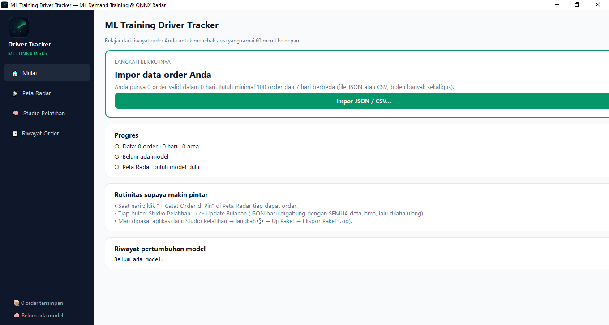
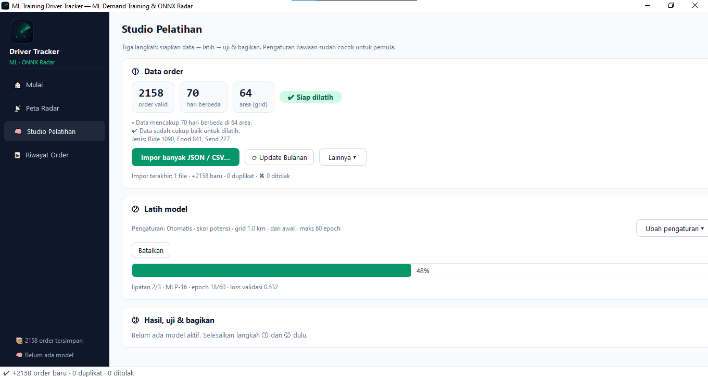
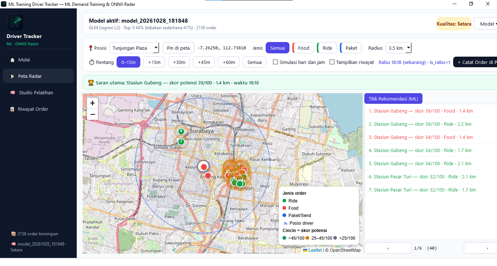
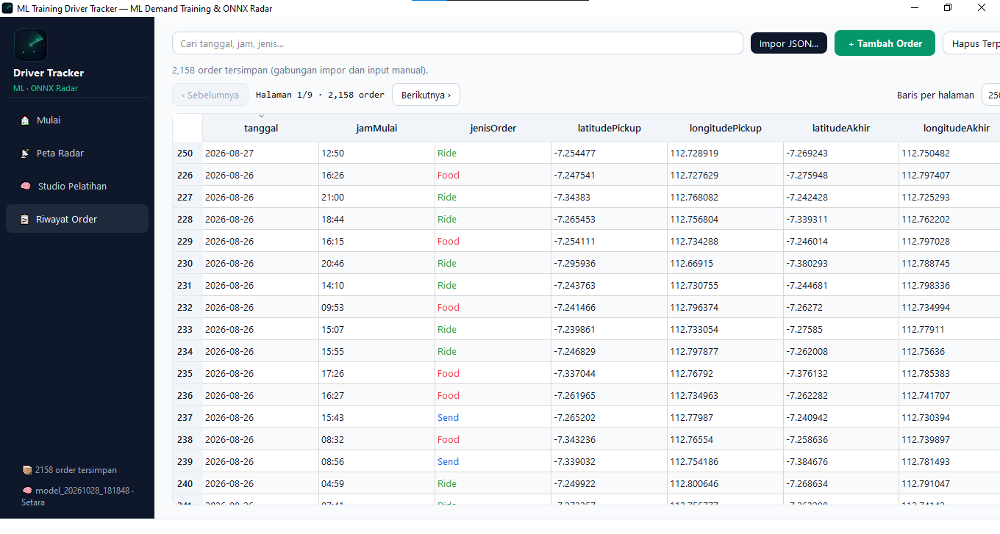

# ML Training Driver Tracker

ML Training Driver Tracker is a desktop application for learning time and location patterns from driver order history. Train an ONNX model, explore demand-potential areas on a radar map, and export a tested model package for use in other Python applications.

## Screenshots

### Home



### Training studio



### Radar map



### Order history



## Features

### Explore demand on the radar map

- View recommended pickup areas up to 60 minutes ahead.
- Choose a driver position from a hotspot or pin a location on the map.
- Filter by order type and choose a 2 km, 3.5 km, or 5 km radius.
- Compare dates and times with simulation mode, or use the current time.
- Show nearby order history and record a new order at the selected pin.
- Use Leaflet and OpenStreetMap tiles; an internet connection is needed to load map assets.

### Import data and train models

- Import multiple JSON or CSV files, import a folder, paste JSON, or enter orders manually.
- Merge new records with saved history and skip duplicates.
- Review valid order, day, and area counts before training.
- Train a GLM or MLP, or let the application select a model using validation results.
- Configure grid size, target, epochs, date range, cross-validation, calendar features, and warm start.
- Review Top-5 hit rate, ROC-AUC, coverage, and simple-baseline comparisons.

### Manage and export models

- Save trained ONNX models and their metadata locally.
- Load the latest model or import an ONNX model with its matching metadata file.
- Test a standalone model package before exporting it as a ZIP.
- Export the model and metadata separately when needed.

**Score interpretation:** Map scores from 0 to 100 are relative demand-potential scores for comparing areas. They are not absolute probabilities or guarantees of an order. Recommendations are limited to pickup areas represented in the training data.

## Project structure

```text
ML-Training-Driver-Tracker/
├── .gitignore                    Git ignore rules
├── README.md                     Project documentation
├── main.py                       Application entry point and navigation
├── requirements.txt              Python dependencies
├── jalankan.bat                  Windows setup and launch script
├── jalankan.sh                   macOS/Linux setup and launch script
├── cek_instalasi.py              Dependency and training-pipeline diagnostic
├── feature_engine.py             Order validation and feature generation
├── ml_onnx_trainer.py            Model training, evaluation, and ONNX runtime
├── package_export.py             Standalone model package creation and tests
├── home_view.py                  Home page and progress summary
├── radar_map_view.py             Radar map and demand recommendations
├── training_studio_view.py       Data import, training, evaluation, and export UI
├── orders_log_view.py            Order history table and editing UI
├── styles.py                     Application styles
├── logo_preview.html             Logo preview page
└── assets/
    ├── app_icon.ico
    ├── logo.png
    ├── logo_32.png
    ├── logo_64.png
    ├── logo_128.png
    └── logo_256.png
```

Training creates a `models/` directory for ONNX models, metadata, and model history. The application also creates `orders_data.json` for saved orders and `orders_data.bak` as an automatic backup.

## Technology and requirements

- Python 3.10 or later; Python 3.12 is recommended for ONNX package compatibility.
- PySide6 with Qt WebEngine for the desktop interface and embedded map.
- NumPy, ONNX, and ONNX Runtime (see `requirements.txt`).
- Internet access for first-time package installation and for Leaflet/OpenStreetMap map assets.
- Current geographic validation covers Surabaya Raya, Sidoarjo, and Gresik. The bounds are defined in `feature_engine.py`.

Order data and model files are stored locally in the project folder. Model metadata contains aggregate order counts by area and training metrics; review it before sharing a model if the underlying location patterns are sensitive. The calendar features include estimates for East Java school and college breaks, so those estimates may need updating.

## Run from source

Extract the complete project folder, then launch the setup script:

**Windows:** double-click `jalankan.bat`.

**macOS/Linux:**

```bash
bash jalankan.sh
```

The scripts create a local virtual environment, install dependencies when needed, run the installation check, and start the application.

To install and launch manually:

```bash
python -m venv venv
# Windows: venv\\Scripts\\activate
# macOS/Linux: source venv/bin/activate
python -m pip install -r requirements.txt
python cek_instalasi.py
python main.py
```

## Order data format

JSON files may contain a list of order objects or a single object. CSV files use the same field names as headers:

| Field | Description | Example |
|---|---|---|
| `tanggal` | Date in `YYYY-MM-DD` format | `2026-09-01` |
| `jamMulai` | Local time in `HH:MM` format | `08:15` |
| `jenisOrder` | Ride, Food, or Paket/Send | `Ride` |
| `latitudePickup` | Pickup latitude | `-7.2625` |
| `longitudePickup` | Pickup longitude | `112.7381` |
| `latitudeAkhir` | Destination latitude | `-7.2655` |
| `longitudeAkhir` | Destination longitude | `112.7523` |

Use **Studio Pelatihan → Lainnya → Unduh template format** to create a sample JSON file. Missing or invalid destination coordinates are treated as the pickup location. Common Indonesian order-type labels are normalized to Ride, Food, or Send. Invalid dates, times, pickup coordinates outside the supported region, and dates more than one day in the future are rejected. Duplicate records are skipped.

Training requires at least 100 valid orders across 7 distinct days. Around 300 orders, 14 days, and 5 or more areas are recommended for more stable results. **Muat data contoh** is for trying the application and is not real order history.

## Troubleshooting

- **A project module such as `home_view` is missing:** extract the complete project archive into a new folder.
- **A dependency such as PySide6 or ONNX Runtime is missing:** activate the project environment and run `python -m pip install -r requirements.txt`.
- **ONNX installation fails:** use Python 3.12 and check your internet connection.
- **The map is blank:** check access to Leaflet and `tile.openstreetmap.org`; the other application pages can still be used.
- **The application fails to start:** run `python cek_instalasi.py` in the project folder. If the issue remains, include its output and `error_log.txt` when reporting it.

## Map attribution

The map uses Leaflet and OpenStreetMap tiles, with © OpenStreetMap attribution shown on the map. Follow the OpenStreetMap tile usage policy when using the application.

